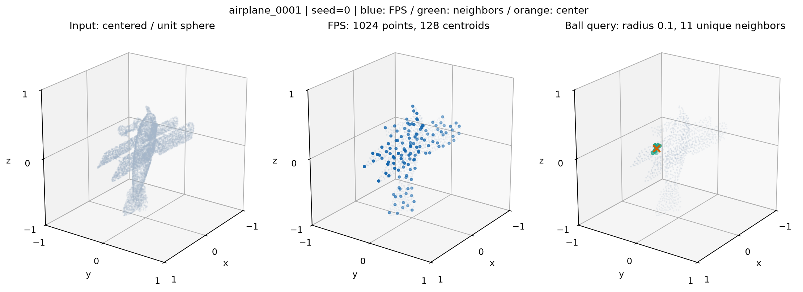

# PointCloud Explore · 点云分类与局部邻域实验

我用这个项目记录自己对 PointNet、PointNet++ 和 DGCNN 的源码阅读、实验改动和运行验证。我的关注点是：点云如何被采样、局部邻域如何构建，以及这些操作怎样进入分类网络。

项目基于已有开源实现。我保留原作者的代码来源和许可证，将自己的工作集中在实验设置、数据接入、邻域分析和复现流程上。目前展示范围是 **ModelNet40 分类与采样分析**；子仓库中的分割与 TensorFlow 代码来自上游，不属于本次验证范围。



上图由真实 ModelNet40 样本 `airplane_0001` 生成：输入 10,000 个点，经中心化和单位球归一化后，FPS 采样 1,024 个点，再选择 128 个中心点。固定随机种子为 0，选中中心的半径 0.1 邻域中有 11 个点，Ball Query 返回 16 个索引，其中只有 11 个不同索引。这是我用来理解固定邻域大小与重复填充行为的一个具体例子。[运行参数与统计](docs/assets/sampling_demo.json)

## 我做了哪些改动

| 位置 | 我的改动 | 实验目的 / 边界 |
|---|---|---|
| PointNet 分类 | 关闭 feature transform，保留输入坐标变换；损失兼容没有特征变换矩阵的情况 | 用于观察特征变换分支；尚未完成受控消融，不能据此声称提升精度 |
| PointNet++ MSG 分类 | 第一层半径由 `[0.1, 0.2, 0.4]` 改为 `[0.2, 0.4, 0.8]` | 探索更大的局部感受范围；每个尺度的采样数量保持 `[16, 32, 128]` |
| MSG 邻域分析 | 增加首次前向传播时的半径、分组形状、首个中心去重邻居数输出 | 分类和两个 MSG 分割模型的第一层启用；分割效果未验证 |
| DGCNN 数据接入 | 分类入口改读 ModelNet normal-resampled 文本数据，取 XYZ 和前 N 个点 | 与 PointNet 使用相同文件来源，但预处理尚不完全相同 |
| DGCNN 源码阅读 | 补充图特征索引与张量维度注释 | 网络主干仍来自上游 |
| 可移植性 | 数据路径参数化、Windows 文件复制、CPU 设备适配、单样本评估修复 | 降低换机器复现的成本 |
| 展示与验证 | 采样图与 JSON 导出、依赖说明、CPU 回归与训练冒烟测试 | 验证代码流程，不替代完整数据集的性能评估 |

更详细的改动与验证边界见 [改动记录](docs/CHANGES.md) 和 [验证说明](docs/VALIDATION.md)。

## 项目结构

```text
PointNet_Explore/
├─ Pointnet_Pointnet2_pytorch/       # 独立模型仓库，发布时登记为子模块
├─ dgcnn/                           # 独立模型仓库，发布时登记为子模块
├─ visualization_pointnet2_sampling.py
├─ test_gpu.py                      # 查看 PyTorch / CUDA 状态
├─ requirements.txt
├─ tests/                          # 无需下载数据的回归与训练冒烟测试
└─ docs/                           # 改动、验证说明和演示图
```

## 安装与数据准备

本次本地验证使用 Windows、Python 3.11.9、PyTorch 2.5.1+cu121。依赖范围见 `requirements.txt`，具体已验证版本见 [验证说明](docs/VALIDATION.md)。CUDA 构建取决于本机环境；仅查看演示或运行小规模测试可使用 CPU。

仓库发布并登记子模块后，可以完整克隆：

```powershell
git clone --recurse-submodules https://github.com/ATree-PointCloud/PointNet_Explore.git
cd PointNet_Explore
python -m venv .venv
.\.venv\Scripts\Activate.ps1
python -m pip install -r requirements.txt
python test_gpu.py
```

准备 **ModelNet40 normal-resampled 文本版**，不是 DGCNN 上游的 HDF5 版本。来源说明保留在 [PointNet 上游文档](Pointnet_Pointnet2_pytorch/README.md)。数据不随本项目分发，目录应为：

```text
modelnet40_normal_resampled/
├─ modelnet40_shape_names.txt
├─ modelnet40_train.txt
├─ modelnet40_test.txt
├─ airplane/
│  └─ airplane_0001.txt             # 每行 x,y,z,nx,ny,nz，逗号分隔
└─ ...
```

在 PowerShell 中配置一次，三个运行入口都可以使用：

```powershell
$env:MODELNET40_ROOT = "D:\datasets\modelnet40_normal_resampled"
```

也可在各命令后追加 `--data_root "D:\datasets\modelnet40_normal_resampled"`，优先级高于环境变量。相对路径相对于当前工作目录；建议跨目录运行时使用绝对路径。未配置时，PointNet 默认查找其仓库下的 `data/modelnet40_normal_resampled`，DGCNN 默认查找 `pytorch/data/modelnet40_normal_resampled`，演示脚本默认查找主仓库下的同名数据目录。没有数据时会给出缺失文件与配置提示，不会自动下载。

## 运行示例

以下命令使用上述环境变量，在激活的虚拟环境中执行。训练示例用于启动实验，默认不代表论文设置或公平对比配置。

**采样与邻域展示**（在主仓库目录）：

```powershell
python visualization_pointnet2_sampling.py --sample_index 0 --seed 0 --output docs/assets/sampling_demo.png
```

可调整 `--num_points`、`--centroids`、`--radius`、`--neighbors`；省略 `--output` 时只打印统计，不打开窗口。脚本不需要 Open3D。

**PointNet 分类与评估**：

```powershell
cd Pointnet_Pointnet2_pytorch
python train_classification.py --model pointnet_cls --log_dir pointnet_no_feature_transform --epoch 200 --workers 0
python test_classification.py --log_dir pointnet_no_feature_transform --num_votes 1 --workers 0
```

**PointNet++ MSG 分类与评估**（仍在同一目录）：

```powershell
python train_classification.py --model pointnet2_cls_msg --log_dir pointnet2_msg_radius --epoch 200 --workers 0
python test_classification.py --log_dir pointnet2_msg_radius --num_votes 1 --workers 0
cd ..
```

没有 CUDA 时，两类 PointNet 命令都追加 `--use_cpu`。模型权重保存在对应实验目录的 `checkpoints/best_model.pth`。评估时应保持与训练相同的点数、法向量及采样参数；同名训练目录可能自动加载已有权重，独立实验请使用新名称。

**DGCNN 分类与评估**：

```powershell
cd dgcnn/pytorch
python main.py --model dgcnn --exp_name dgcnn_modelnet40 --num_points 1024 --k 20 --epochs 250 --workers 0
python main.py --model dgcnn --exp_name dgcnn_eval --num_points 1024 --k 20 --eval --model_path checkpoints/dgcnn_modelnet40/models/model.t7
cd ../..
```

没有 CUDA 时追加 `--no_cuda`。布尔参数也兼容 `--use_sgd false`、`--eval true`。DGCNN 的数据增强随机数与 PyTorch 随机数使用 `--seed` 初始化；GPU 完全确定性不在本次验证范围内。

## 当前完成程度

我已经整理了个人改动，并验证数据读取、CPU 推理、训练保存与重新加载流程。当前没有用整理后的代码重新跑完整 ModelNet40 基准，所以不在这里给出精度排名或性能提升结论。上游 README 中的成绩属于原作者，历史日志也不等于当前代码的复现实验结果。

尤其需要区分：PointNet 数据加载会对所选点进行中心化和单位球归一化；我当前的 DGCNN 文本加载保留输入 XYZ 尺度，并在训练时缩放、平移和打乱点。两者使用同一批源文件不等于相同预处理，后续公平对比还需要统一采样、归一化、训练轮次与随机种子。

无需下载数据即可验证工程流程：

```powershell
python tests/test_portability.py
python tests/smoke_training.py
```

后续我计划补齐受控的特征变换消融、MSG 半径对比，以及统一预处理后的模型评估记录。

## 来源

- PointNet / PointNet++ 实现来自 [yanx27/Pointnet_Pointnet2_pytorch](https://github.com/yanx27/Pointnet_Pointnet2_pytorch)。
- DGCNN 实现来自 [WangYueFt/dgcnn](https://github.com/WangYueFt/dgcnn)。
- 子仓库原有 MIT 许可证与作者署名予以保留，详见 [来源说明](THIRD_PARTY.md)。
